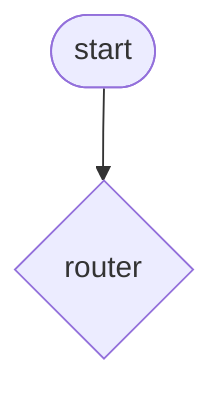
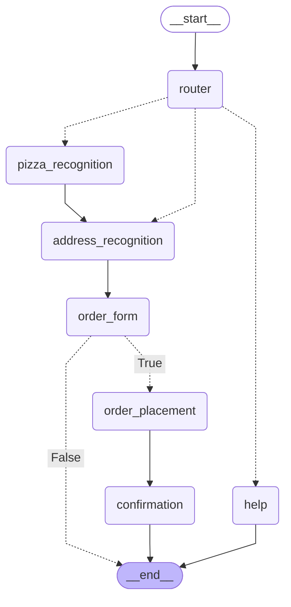

# Process model -- team Kleanthis Vasileiadis

This file is a deliverable. Fill it in *before* you implement (Tasks 3a, 4a, 5a), and complete the last sections after you have exported the diagram (Task 2).

Which section belongs to which task:

| section | filled during |
| --- | --- |
| 0. three answers about the demo graph | Task 1 |
| 1. the dialog as a sequence | Task 5a, from the run in Task 6 |
| 2. the components and their contracts | Tasks 3a, 4a, 5a |
| 3. the process, drawn by hand | Tasks 3a and 4a (one component each), 5a (the whole process) |
| 4. the exported process model | Task 2, with `--pizza` in Task 6 |
| 5. differences between 3 and 4 | Task 6 |
| 6. cases our rules cannot handle | Tasks 3c and 4c |
| 7. contract hand-over | Task 7 |
| 8. our baseline | if time is left today (end of the sheet), at the latest in Iteration 3 |

## 0. Three answers about the demo graph (Task 1)

1. A node returns `{"style": "formal"}`. What happens to the other fields of the state?
The other fields of the state remain unchanged. Only the "style" field is updated.

2. `choose_style` returns a string. Why is that *not* a state change, and why does it matter for the diagram?
Choose_style is a router node, meaning that it decided what node to execute next and not change the contents of the state.

3. Where would you look to find out why the bot chose the formal branch: in the code, or in the log? What does your answer imply for a system that runs in production?
I would look to find the answer in the log since trace.decision() traces the selected branches and the reason for the decision

## 1. The dialog, as a sequence

Who says what, in the shortest complete order. One line per turn. Mark for every bot turn which component produced it.

| # | speaker | utterance | component | state after the turn |
| --- | --- | --- | --- | --- |
| 1 | user | I would like a Margherita | - | pizza_name = Margherita |
| 2 | bot | Where should we deliver? Street, house number and city, for example: 5 Ermou, Athens. | order_form | pizza_name = Margherita, expected = address |
| 3 | user | 5 Ermou, Athens | - | pizza_name = Margherita, address = Ermou, 5, Athens |
| 4 | bot | Your Margherita is on its way to 5 Ermou, Athens. Order id:8e8f08e0-63cd-4673-9f42-77c088f4d667. | confirmation | pizza_name = Margherita, address = Ermou, 5, Athens, order_id = 8e8f08e0-63cd-4673-9f42-77c088f4d667, ended = True |

## 2. The components and their contracts

One row per component. Copy the contract from the docstring in the code -- or, better, write it here first and copy it into the code afterwards.

One row per component, in the six parts from the reference section of the sheet. Copy the contracts of the three components you implement (`pizza_recognition`, `address_recognition`, `order_form` with `router` and `slots_complete`); for the given ones (`order_placement`, `confirmation`, `help`) one line each is enough.

| component | reads | writes | calls | rule(s) | guarantee | failure behaviour |
| --- | --- | --- | --- | --- | --- | --- |
| router | state["input"], state["expected"], state["slots"] | the name of the node that runs next | GET /pizza | 1. if `expected` names a slot, the turn goes to the component that fills it: "pizza_name" -> pizza_recognition, "address" -> address_recognition 2. an utterance with ordering intent, or naming an item of the menu, or arriving while an order is in progress, starts the ordering branch (the router of slide 1.34 knows only "order" and "pizza"; this one adds ORDER_INTENT and the menu) 3. anything else gets help | returns exactly one of: "pizza_recognition","address_recognition", "help" | - |
| pizza_recognition | state["input"], state["slots"], state["expected"] | slots.pizza_name, slots.pizza_id | GET /pizza | 1. the menu is data: names come from GET /pizza, never from code 2. a menu name mentioned literally in the utterance wins (compared case-insensitively) 3. otherwise: one token of the utterance is close to a menu name-- difflib ratio >= 0.80, token of >= 4 letters, both sides lower-cased for the comparison 4. several candidates -> the first one in menu order wins | slots.pizza_name, slots.pizza_id, The component never writes any other | nothing recognised -> empty patch `{}`|
| address_recognition | state["input"], state["slots"], state["expected"] | slots.address | POST /address/validate | 1. two accepted orders, both ending in ", <city>": "5 Ermou, Athens"   (number first) "Ermou 5, Athens"   (number last -- how Greek addresses are written) 2. filler words around the match are removed, not parsed 3. the address is checked against POST /address/validate | complete or nothing | empty patch `{}` |
| order_form | state["slots"], state["expected"] | expected, messages | - | 1. ask for the first missing slot, in the order of REQUIRED 2. asking twice for the same slot is prefixed with REPEAT, so the user hears that we did not understand 3. nothing missing -> say nothing, set expected = None | always names the slot that question was about (or None) | none |
| slots_complete | state["slots"] | True when every slot of REQUIRED is present, False otherwise | - | - | True is only ever returned for a frame that order_placement can use | none |
| order_placement | | | | | | |
| confirmation | | | | | | |
| help | | | | | | |

## 3. The process, drawn by hand

Draw it on paper or in Mermaid -- both count, as long as every node, every edge and every decision is visible. Inputs and outputs belong on the arrows, not only in your head.

## 4. The exported process model (Task 2)

Run `python demo_visualize.py --pizza`, then paste the content of `docs/pizza-process-model.mmd` here and commit `docs/pizza-process-model.png` next to it.

## 5. Differences between 3 and 4

The wiring in `pizzabot/graph.py` is given, so a difference means that your picture of the process is not the process you were given: either you drew something the code does not do, or the code does something you did not expect. Correct the drawing; if you think the code is wrong, write it down as a change request for Iteration 2.

| # | what differs | which one is wrong | what we changed |
| --- | --- | --- | --- |
| 1 | | | |

## 6. Cases our rules cannot handle (keep this list)

The utterances where a static rule gives up. This list is not a failure report, it is the specification for Iteration 2 -- these are the cases an LLM will be asked to take over, and the measurement in Iteration 3 will use exactly them.

Three kinds, and the difference matters: *(a) the type lacks a field* (a postcode has nowhere to go), *(b) the pattern is too narrow* (a comma is missing), *(c) the rule applies and the answer is still wrong* (`28is Oktovriou 5, Athens` accepted as street `Oktovriou`). Iteration 3 measures the third kind.

| # | utterance | what should happen | what happens now | why the rule fails | kind (a/b/c) |
| --- | --- | --- | --- | --- | --- |
| 1 | Deliver to 5 Ermou Athens | Recognize house number 5, street Ermou, and city Athens. | The address pattern does not match the expected format. | Both address patterns require a comma before the city. | b |
| 2 | Deliver to 5 Ermou Street, Athens, 105 63 | Recognize the street, house number, city, and postcode. | The postcode is not stored as part of the address. | The address structure has no postcode field, and the regex does not capture a postcode separately. | a |
| 3 | Deliver to 28is Oktovriou 5, Athens | Recognize street 28is Oktovriou, house number 5, and city Athens. | The parser may interpret Oktovriou as the street and 28 as the house number, or otherwise extract incorrect components. | NUMBER_LAST can interpret the leading number in a street name as the house number because it is designed for addresses where the house number comes last. | c |
| 4 | Deliver to 5 Ermou, Athens, Attica | Recognize street Ermou, house number 5, and city Athens, with Attica handled separately if supported. | The city capture may include Athens, Attica, causing address validation to fail. | The CITY pattern permits spaces and hyphens, but does not explicitly separate a city from a region. | b |
| 5 | Deliver to apartment 5, 12 Ermou Street, Athens | Recognize the correct street and house number, ignoring the apartment number or storing it separately. | The parser may fail to match the address or extract incorrect components. | The patterns do not explicitly support apartment numbers or additional address details before the street. | b |

## 7. Contract hand-over (Task 7)

We implemented the `address_recognition` contract of team ____________, and team ____________ implemented ours.

| # | row that came out differently | which part failed us? (reads / writes / calls / rules / guarantee / failure) | was the contract silent, or did we read it differently? | the sentence that would have prevented it |
| --- | --- | --- | --- | --- |
| 1 | | | | |
| 2 | | | | |

The sentences from the last column, added to our own contract:

*

## 8. Our baseline (if time is left)

The number Iteration 3 will compare against. Count the rows in your own validation cases that the bot gets right today.

| date | cases | correct | notes |
| --- | --- | --- | --- |
| | | | |
